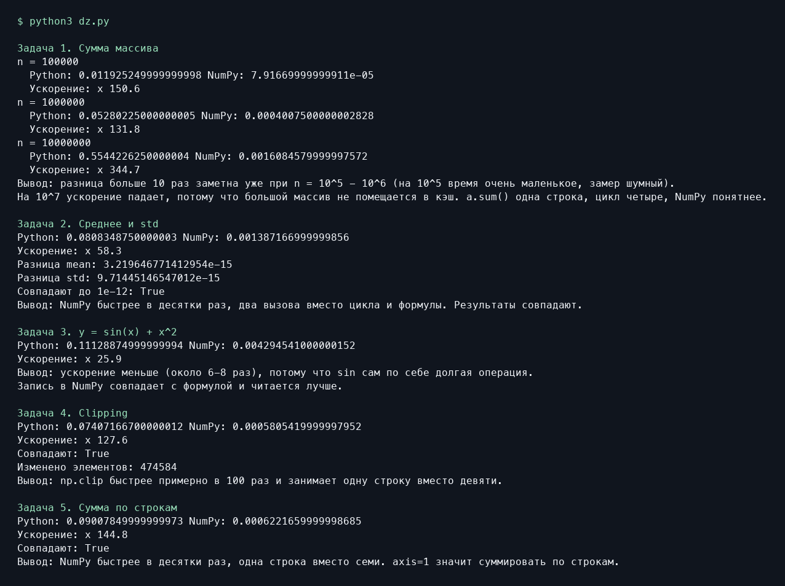

# Численные методы. Сравнение Python и NumPy

В работе сравнивается время выполнения пяти операций с массивами в циклах Python и с помощью NumPy. Скрипт с решениями — [dz.py](dz.py).

## Запуск

```bash
python3 -m pip install numpy
python3 dz.py
```

## Результаты запуска

| Задача | Размер данных | Ускорение NumPy |
| --- | ---: | ---: |
| Сумма массива | 100 000 | 150,6× |
| Сумма массива | 1 000 000 | 131,8× |
| Сумма массива | 10 000 000 | 344,7× |
| Среднее и стандартное отклонение | 1 000 000 | 58,3× |
| Вычисление sin(x) + x² | 1 000 000 | 25,9× |
| Ограничение значений от 0 до 1 | 1 000 000 | 127,6× |
| Сумма по строкам | 100 000 × 10 | 144,8× |

Ускорение — отношение времени выполнения Python ко времени выполнения NumPy. Таблица отражает один запуск. Числа зависят от машины и нагрузки, а пояснения, которые печатает скрипт, содержат ориентировочные оценки.

Среднее и стандартное отклонение совпали с точностью до 10⁻¹². Для ограничения значений и суммы по строкам проверка `np.allclose` вернула `True`.



## Исходный код

```python
import time
import math
import numpy as np

print("Задача 1. Сумма массива")
for n in [10**5, 10**6, 10**7]:
    a = np.random.rand(n)
    a_list = a.tolist()

    start = time.perf_counter()
    s = 0
    for x in a_list:
        s += x
    t_py = time.perf_counter() - start

    start = time.perf_counter()
    s2 = a.sum()
    t_np = time.perf_counter() - start

    print("n =", n)
    print("  Python:", t_py, "NumPy:", t_np)
    print("  Ускорение: x", round(t_py / t_np, 1))
print("Вывод: разница больше 10 раз заметна уже при n = 10^5 - 10^6 (на 10^5 время очень маленькое, замер шумный).")
print("На 10^7 ускорение падает, потому что большой массив не помещается в кэш. a.sum() одна строка, цикл четыре, NumPy понятнее.")
print()


print("Задача 2. Среднее и std")
n = 10**6
a = np.random.rand(n)
a_list = a.tolist()

start = time.perf_counter()
s = 0
s2 = 0
for x in a_list:
    s += x
    s2 += x * x
mean1 = s / n
std1 = math.sqrt(s2 / n - mean1 * mean1)
t_py = time.perf_counter() - start

start = time.perf_counter()
mean2 = a.mean()
std2 = a.std()
t_np = time.perf_counter() - start

print("Python:", t_py, "NumPy:", t_np)
print("Ускорение: x", round(t_py / t_np, 1))
print("Разница mean:", abs(mean1 - mean2))
print("Разница std:", abs(std1 - std2))
print("Совпадают до 1e-12:", abs(mean1 - mean2) < 1e-12 and abs(std1 - std2) < 1e-12)
print("Вывод: NumPy быстрее в десятки раз, два вызова вместо цикла и формулы. Результаты совпадают.")
print()


print("Задача 3. y = sin(x) + x^2")
n = 10**6
a = np.random.rand(n)
a_list = a.tolist()

start = time.perf_counter()
y1 = []
for x in a_list:
    y1.append(math.sin(x) + x * x)
t_py = time.perf_counter() - start

start = time.perf_counter()
y2 = np.sin(a) + a**2
t_np = time.perf_counter() - start

print("Python:", t_py, "NumPy:", t_np)
print("Ускорение: x", round(t_py / t_np, 1))
print("Вывод: ускорение меньше (около 6-8 раз), потому что sin сам по себе долгая операция.")
print("Запись в NumPy совпадает с формулой и читается лучше.")
print()


print("Задача 4. Clipping")
n = 10**6
a = np.random.normal(0.5, 0.7, n)
a_list = a.tolist()

start = time.perf_counter()
res1 = []
for x in a_list:
    if x < 0:
        res1.append(0)
    elif x > 1:
        res1.append(1)
    else:
        res1.append(x)
t_py = time.perf_counter() - start

start = time.perf_counter()
res2 = np.clip(a, 0, 1)
t_np = time.perf_counter() - start

print("Python:", t_py, "NumPy:", t_np)
print("Ускорение: x", round(t_py / t_np, 1))
print("Совпадают:", np.allclose(res1, res2))
print("Изменено элементов:", np.sum((a < 0) | (a > 1)))
print("Вывод: np.clip быстрее примерно в 100 раз и занимает одну строку вместо девяти.")
print()


print("Задача 5. Сумма по строкам")
n = 10**5
m = np.random.rand(n, 10)
m_list = m.tolist()

start = time.perf_counter()
result = [0] * n
for i in range(n):
    s = 0
    for j in range(10):
        s += m_list[i][j]
    result[i] = s
t_py = time.perf_counter() - start

start = time.perf_counter()
result2 = m.sum(axis=1)
t_np = time.perf_counter() - start

print("Python:", t_py, "NumPy:", t_np)
print("Ускорение: x", round(t_py / t_np, 1))
print("Совпадают:", np.allclose(result, result2))
print("Вывод: NumPy быстрее в десятки раз, одна строка вместо семи. axis=1 значит суммировать по строкам.")
print()
```
